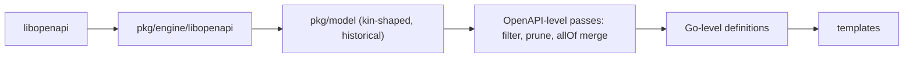
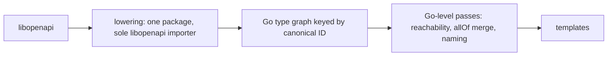

# Target architecture: libopenapi-native generator

This is the shape to work toward now that the kin-openapi to libopenapi migration has finished: kin-openapi is removed from every module and libopenapi is the only engine. Every step must keep the generated output identical. The golden files under `internal/test` and `examples` are the acceptance gate.

## Where the migration left us

- `pkg/model` still mirrors kin's API (`SchemaRef{Ref, Value}`, `Types`, extensions as `any`), a leftover of the port, which was mostly mechanical. kin itself is gone, so nothing outside this shape depends on it.
- The kin engine, the `engine` option and the engine-parity tests are removed. The golden files are the only parity gate now.
- The examples validate requests with libopenapi-validator (`examples/internal/requestvalidator`).
- Filtering and pruning delete things from the model in place.
- The allOf merge builds new OpenAPI schemas, which are then lowered again into Go types.
- About 100 reads of `globalState` carry the spec, options, import mapping and content-type tags.

## Target

### Principles

1. **One importer of the library.** Only the lowering package imports libopenapi. Keep that boundary as thin as is practical, because libopenapi is also pre-1.0.
2. **Canonical identity.** Every schema, parameter, response and path item has an ID made of its absolute document path plus JSON pointer, taken from the libopenapi index. Nothing compares by pointer.
3. **Selection by reachability, not deletion.** The tag and operation-ID filters choose root operations; the emitted components are whatever those roots reach through the index. `skip-prune` means "emit every component". Nothing gets mutated.
4. **Merge Go types, not OpenAPI schemas.** allOf combines property sets, required lists and constraints into a struct type directly. It never builds an intermediate OpenAPI schema.
5. **Typed extensions with source positions.** Each `x-*` extension is decoded once from its YAML node into a small Go struct, keeping line and column. Validation and generation errors report the location in the spec.
6. **Explicit context.** Options, import mapping, content-type tags and naming state go through a context value passed down the passes. No package-level `globalState`.
7. **Declaration order from the source.** Use libopenapi's ordered maps and node positions for path and property order, instead of sorting or reading `Origin`.

### Kept as-is

- The configuration format and every option.
- The templates and the template data types (`TypeDefinition`, `OperationDefinition`, `ParameterDefinition` and the rest), apart from the fields that expose raw spec structs.
- The naming, collision-resolution and type-mapping rules, together with the kin-era behaviours that today's output encodes (number formatting, how 3.0 `nullable` and 3.1 `type: null` combine, `$ref` with sibling keys, names derived from external refs).

## Advantages over the migration end state

- **One fewer layer.** No OpenAPI-shaped model to keep in sync with libopenapi.
- **Simpler pruning and filtering.** One reachability function replaces the kin-style walker in `prune.go` (about 480 lines) and the deletions in `filter.go`.
- **A smaller, clearer allOf merge.** Merging at the Go-type level removes the round trip of building a new schema and lowering it again, which is the most complex code path today (`merge_schemas_allof.go`).
- **Better diagnostics.** Every error can name the file, line and column.
- **Safe to run in parallel and to test.** Without global state, generation can run concurrently, and each pass can be unit-tested on its own.
- **Nothing left over from kin.** No model names or value encodings chosen only so the port would be mechanical.

## Incremental path

Each step lands separately, with no diff in generated output.

1. Drop kin-specific shapes from `pkg/model`, for example `Types` becomes `[]string`, and decode extensions into typed structs.
2. Replace `filter.go` and `prune.go` with reachability from the root operations.
3. Replace `globalState` with an explicit context value.
4. Move the allOf merge from OpenAPI schemas to Go types.
5. Fold `pkg/model` into the lowering package if the remaining layer no longer earns its keep. Keep it if libopenapi's API churn justifies the insulation.
